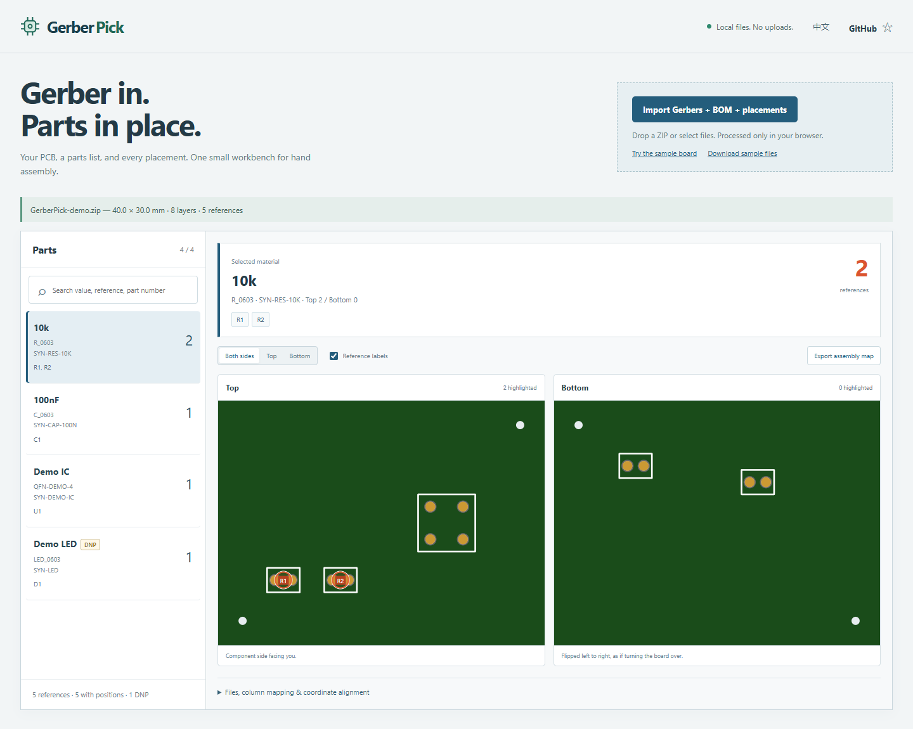

# GerberPick

**Gerber in. Parts in place.**

Turn fabrication files into a click-to-find PCB assembly map. Select a resistor, capacitor or IC in the BOM and see every matching placement on both sides of the board.

[**Open the workbench**](https://lizilaila.github.io/gerber-pick/) · [Download](https://github.com/LiziLaiLa/gerber-pick/releases) · [简体中文](README.zh-CN.md)



## A small tool for the soldering bench

- **Drop a Gerber ZIP or select files.** Render top/bottom copper, soldermask, silkscreen, outline and Excellon drills with the tracespace renderer.
- **Find every part.** Join BOM and placement references, group matching materials, show quantities, and highlight all matching positions. Search by value, reference or part number.
- **Keep both sides straight.** Bottom view follows the actual board flip. Placement units, origins, Y direction and already-mirrored bottom coordinates are explicit and adjustable.
- **Map unfamiliar spreadsheets.** CSV/TSV header detection covers common English/Chinese exports. Choose columns manually when needed. KiCad `.pos` files work too.
- **Export a portable assembly map.** A ZIP with a script-free HTML viewer and two board images. Unzip everything, open `index.html`, and click materials without running this app.
- **Keep board files local.** No login, analytics, upload endpoint or runtime CDN. The importer reads your files in browser memory. Only the bundled sample is fetched from this site.
- **English and Chinese.** One workbench, a language switch, and a layout that also fits a phone.

### Does Gerber alone contain the BOM?

Usually **no**. Standard Gerbers describe layer artwork, not a complete material list or exact component centers.

| What you import | What you get |
| --- | --- |
| Gerbers / drills | A two-sided board viewer |
| Gerbers + BOM | Material groups and counts; references without placements stay unlocated |
| Gerbers + CPL / PnP / `.pos` | Locations; material identity uses whatever the placement file supplies |
| Gerbers + BOM + placements | The full assembly map |

Gerber X2 pin/reference attributes are shown as evidence, not invented component centers. Full X3 component-layer import is **not implemented** in this release. Unknown material identities remain separate rather than being silently merged.

## Exporting your files

Export **all layers and placements with the same coordinate origin**. Include the board outline. Use matching reference designators in the BOM and placement table.

| CAD / service | Files to select |
| --- | --- |
| KiCad | Gerbers + Excellon drill, BOM CSV, and position `.pos` or CSV; position-file headers provide units |
| EasyEDA / JLCPCB | Gerber ZIP, BOM CSV, and Pick and Place / CPL CSV (`Designator`, `Mid X`, `Mid Y`, `Layer`, `Rotation`) |
| Altium / other CAD | Gerbers + drill, BOM CSV/TSV, and placement CSV; use column mapping for your export headers |

XLSX, ODB++, IPC-2581 and 3D models are not accepted. Export tables as UTF-8 CSV/TSV. GB18030 text is also decoded for common Chinese exports.

If units are absent, choose them under **Files, column mapping & coordinate alignment**. The importer does not guess. If positions are off the board, check units and origin before applying offsets. Verify an asymmetric part against your actual board before soldering.

**DNP is explicit:** these references are shown with a DNP badge and dashed markers, and are labelled “do not fit” in exported maps. Counts are listed reference counts, including a separately identified DNP group.

## Run locally

Node.js 22+:

```sh
npm ci
npm test
npm run build
npm run dev
```

Open the local URL printed by the server. `PORT=8080 npm run dev` changes the port. The default is `127.0.0.1:8795`.

The release's **`gerber-pick-web.zip`** contains the built static app. Serve the unzipped directory with any static server, for example `python -m http.server 8080`. No backend is required. For double-click offline viewing, use the **Export assembly map** output instead.

## Privacy and limits

Imported board files are not uploaded or saved to local storage. Reloading clears the imported project. Download an assembly map if you want to keep it. As with any hosted app, the host receives normal requests for the app's own static files; it never needs your PCB contents.

Current guardrails: 10 MiB per expanded file, 20 MiB total selected input, 50 MiB combined expanded data, 500 ZIP entries, and a 200× entry expansion ratio. Encrypted ZIP, ZIP64, duplicate names and traversal paths are rejected before extraction. Oversized or malformed files produce a specific error; the last successful board stays visible.

This is a **v0.1 assembly aid**, not CAM sign-off, DRC or manufacturing verification. Vendor export variations exist. Unsupported mixed per-face renderer units are rejected instead of producing incorrect alignment. Supported-layer recognition follows tracespace's filename rules and Gerber file-function attributes.

## Development

- `src/importer.js`: file limits, ZIP inspection, CSV / `.pos` parsing, render adapter and coordinate projection.
- `src/app.js`: browser UI, mapping, local image display and portable-map export.
- `fixtures/`: a completely synthetic 40 × 30 mm demo, with a top and bottom component, DNP part, two holes and position/BOM variants.
- `test/importer.test.mjs`: real render tests, independent projection checks for both faces and nonzero/negative origins, inch conversion, mapping, DNP and malformed ZIP cases.

`npm run build` vendors scripts locally and creates `dist/` plus `gerber-pick-web.zip`. The GitHub workflow tests, builds and deploys the static demo to Pages. Runtime dependency licenses are included in the build.

## Credits and license

MIT. Gerber rendering uses [tracespace / pcb-stackup 4.2.8](https://github.com/tracespace/tracespace/tree/main/packages/pcb-stackup), ZIP handling uses [fflate](https://github.com/101arrowz/fflate), and CSV parsing uses [Papa Parse](https://github.com/mholt/PapaParse). Their notices are distributed with the static build. The tracespace v4 renderer is mature but upstream maintenance is limited; the v5 alpha is not used.

Found a board export that doesn't work? Open an issue with the CAD/export settings and a **sanitized, shareable** minimal reproduction. Please do not post confidential board files.

If this saves you a few minutes at the bench, a ⭐ helps other makers find it.
