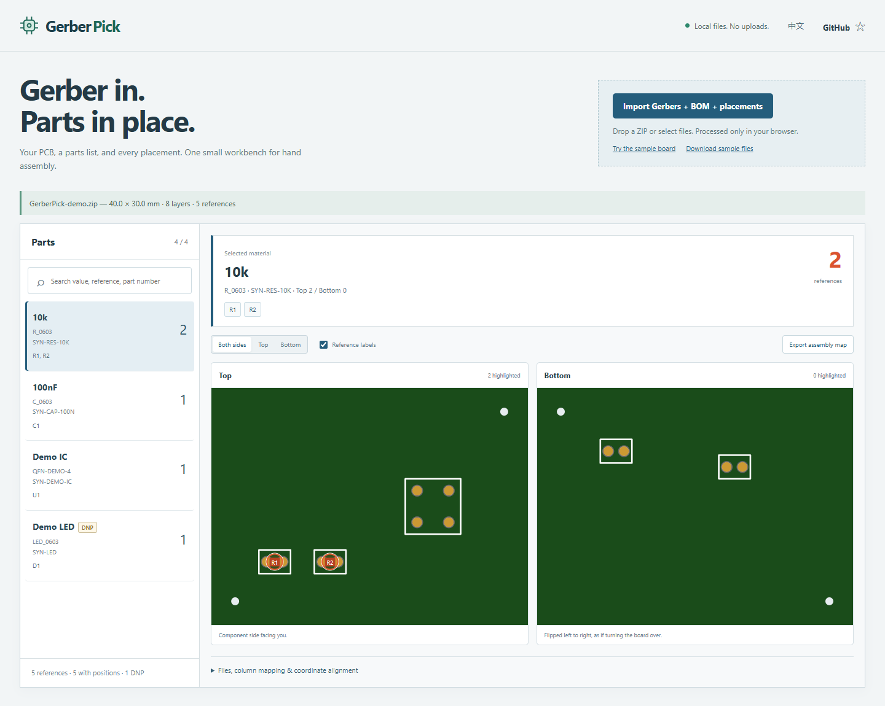

# GerberPick

**导入板图，找到每颗物料。**

[在线使用](https://lizilaila.github.io/gerber-pick/) · [下载版本](https://github.com/LiziLaiLa/gerber-pick/releases) · [English](README.md)



这是一个浏览器本地运行的 Gerber 查看和手工贴片定位工具。导入 Gerber、BOM 和贴片坐标，选择一种物料，就能在正反面板图上看到全部位置与数量。

## 怎么用

1. 拖入一个 ZIP，或一起选择 Gerber/钻孔文件、BOM CSV 和贴片坐标 CSV / KiCad `.pos`。
2. 点击左侧物料，在两面图上查看对应位置。可按规格、位号或料号搜索。
3. 表头或单位不匹配时，展开“文件、列映射与坐标校准”，选择文件/列、单位和原点偏移。
4. 需要留档时点“导出离线贴片图”。将下载包**全部解压**，直接打开其中的 `index.html`，无需脚本或服务器。

普通 Gerber 通常只有光绘板图，不含完整 BOM 和器件中心。因此：只有 Gerber 时可看板图；有 BOM 才有可靠物料参数；有 CPL/PnP/`.pos` 才能准确定位。没有坐标的位号仍保留在清单中，不编造位置。X2 引脚属性不当作器件中心，当前尚不完整支持 X3 元件层。

## 支持什么

- RS-274X Gerber、Excellon 钻孔、ZIP、CSV / TSV、KiCad `.pos`。
- 常见 KiCad、EasyEDA / 嘉立创、JLCPCB 和 Altium 导出的中英表头；未知表头可手动映射。
- mm / inch / mil、正负原点、Y 方向、已镜像的背面 X 坐标校正。
- 正反面位置、同物料归组数量、DNP 标记、独立离线贴片图导出。
- 中英界面，电脑和窄屏布局。

XLSX、ODB++、IPC-2581、3D 模型不在当前范围内。请导出 CSV/TSV。Gerber 与贴片坐标必须使用相同原点，焊接前用实际非对称器件检查方向。DNP 表示不贴：界面和导出图均有明确标记。

## 隐私

板文件只在浏览器内存中读取，不上传、无账号、无统计追踪、不写本地存储。运行依赖都打包在本站，不依赖外部 CDN。刷新后会清空当前导入，需保留时请导出贴片图。站点仅加载自己的静态应用和合成示例。

限制：单个展开文件 10 MiB、总选择 20 MiB、总展开 50 MiB、ZIP 500 项、每项展开比不超过 200 倍；拒绝加密、ZIP64、重名和路径穿越。失败会说明原因，并保留上一块成功显示的板图。

## 本地运行

需要 Node.js 22+：

```sh
npm ci
npm test
npm run build
npm run dev
```

打开终端输出的本机地址。Release 的 `gerber-pick-web.zip` 是完整静态应用，解压后用任意静态服务器打开，例如 `python -m http.server 8080`。若要双击直接查看，请用应用导出的“离线贴片图”。

本项目为 v0.1 装配辅助工具，不代替 CAM/DRC 或制造验收。更多格式限制、架构及依赖致谢见[英文说明](README.md)。示例板全部为自造测试数据。

MIT 开源。如果它帮你少找几颗电阻，欢迎点个 ⭐，让更多做硬件的人看到。
